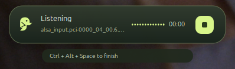

# Parakeet Dictation

Talk to your coding agent without a dictation subscription.

Press a shortcut, speak, press it again. The text pastes into the focused field.
Recognition runs locally on your CPU with NVIDIA's multilingual Parakeet model.
No account, word limit or cloud transcription.



Linux capsule during a microphone check. The Windows workflow is illustrated
[here](docs/demo.gif); that animation is an illustration, not a screen recording.

## Install

| Platform | Route | Recording shortcut |
| --- | --- | --- |
| Windows 10/11 | [Download the ZIP](https://github.com/tristanmuzzu/parakeet-dictation/releases/latest) or build from source | Ctrl+Win |
| Linux, GNOME with XWayland | [Source setup](docs/LINUX.md) | Choose a GNOME binding during setup |
| macOS | Not implemented | |

**Windows:** extract `ParakeetDictation-win64.zip` and launch
`ParakeetDictation.exe`. The first run downloads about 460 MB of model weights.
The executable is unsigned. Use source if you prefer to inspect and build it.

**Linux:** source includes the native capsule, local settings/history and
optional model trials. Those changes are not in the Windows 1.2.1 ZIP.
Read [Linux setup](docs/LINUX.md) before installing desktop hotkeys.

## Send your agent here

> Install https://github.com/tristanmuzzu/parakeet-dictation on this computer.
> Read AGENTS.md and INSTALL.md, then follow the guide for my operating system.
> Use default Parakeet recognition, preserve existing shortcuts, and verify a
> sentence lands in a plain text editor. Ask before enabling login startup.

The guides include dependencies, verification and recovery. An existing install
should be reused, not replaced by a second running copy.

## Use it

On Windows, **Ctrl+Win** starts and stops recording. **Ctrl+Shift+Win** toggles
continuous mode. **Esc** cancels a take and **Ctrl+Alt+Q** quits.
Linux shortcuts depend on your GNOME configuration; the generic installer
defaults to Ctrl+Super+Space.

Recognition processes speech chunks while you talk, then finishes the remaining
audio after stop. Latency depends on the computer and recording. The default
model supports 25 languages and punctuation; expect occasional recognition
errors, especially with names.

The text stays on your clipboard. If paste misses the intended field, focus it
and press Ctrl+V. Local history also keeps transcripts for recovery.

## Teach it your words

Add a correct word or phrase to `dictionary.txt`, one per line. It reloads
without restarting and sound-matches words of four or more letters. For a
specific mistake, use an explicit correction:

```text
cloud code -> Claude Code
```

Your dictionary is local and gitignored. An agent can help maintain it when you
ask. Do not include it in bug reports.

## Privacy and settings

Audio is processed on your machine and is not saved by the app. First-run model
downloads need internet; normal default recognition works offline afterward.
The app stores transcripts locally in `transcripts.log` and, on Linux,
`history.sqlite3`. Clipboard text remains available after insertion. Keep these
files private, along with `dictionary.txt`, settings and diagnostic logs.

Filler cleanup and local prompt editing are optional. On Linux they are off by
default; light editing requires separate local assets. Alternative speech models
are source-only experiments, not required dependencies or default upgrades.
See [Linux options](docs/LINUX.md#optional-models).

## Source setup and development

Windows uses Python 3.10 to 3.12:

```powershell
git clone https://github.com/tristanmuzzu/parakeet-dictation.git
cd parakeet-dictation
.\setup.ps1
.\.venv\Scripts\python.exe selftest.py
.\"Start Dictation (debug).bat"
```

The self-test downloads the default model if missing and prints `SELFTEST_OK`.
Linux needs system GTK bindings and desktop input tools as well as the Python
requirements. Follow [the Linux guide](docs/LINUX.md), not the PowerShell route.

```bash
python3 -m pytest tests/ -q
```

Tests use synthetic audio and isolated stores. They do not prove microphone,
shortcut or paste behavior. Verify those on the target desktop before reporting
a successful installation. [Agent setup guide](INSTALL.md).

## Troubleshooting

- **Shortcut does nothing:** check your configured binding, whether the app is
  running, and whether its model is ready. Windows key names can vary by layout.
- **Microphone error:** check the selected input device and OS microphone access.
- **Text did not appear:** Ctrl+V recovers it. Check the destination's paste
  shortcut and, on Linux, the ydotool daemon/socket.
- **Already running:** executable and source installs share a loopback lock on
  `127.0.0.1:49731`. A second launch exits rather than starting another recorder.

An issue with your OS, Python version and a short reproducible example helps.
Avoid uploading your transcript history or full dictation log.

## License

Code: [MIT](LICENSE). The default speech model is NVIDIA's
[Parakeet TDT 0.6B v3](https://huggingface.co/nvidia/parakeet-tdt-0.6b-v3),
under CC-BY-4.0, downloaded through
[onnx-asr](https://github.com/istupakov/onnx-asr).
Other optional models have their own licenses. Their weights are not bundled.
